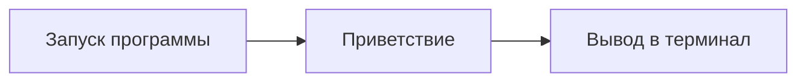
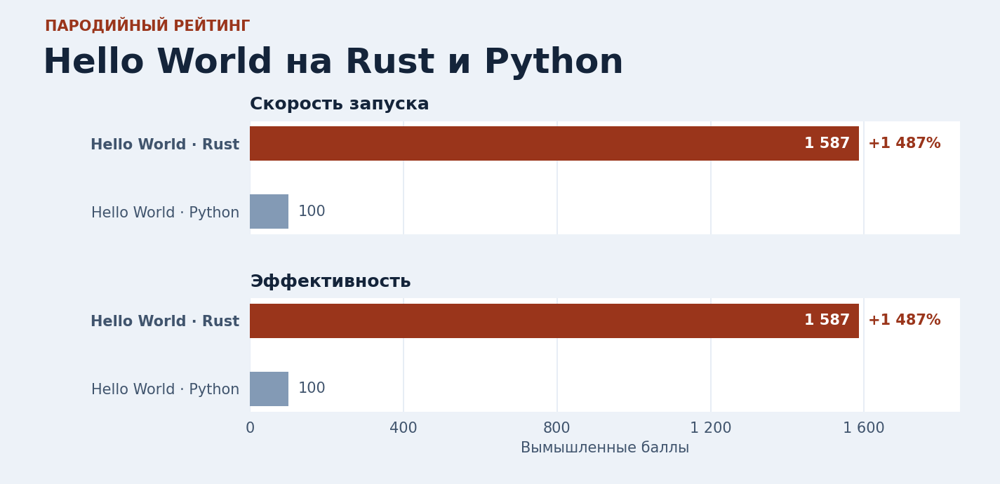

# Hello World

[](https://github.com/seladala/hello-world-rust/actions/workflows/ci.yml)
[](https://github.com/seladala/hello-world-rust/releases/latest)
[](rust-toolchain.toml)

Программа на Rust, которая выводит `hello world` в терминал.

## Запуск

Установите Rust через [rustup](https://rustup.rs/) и выполните команду из корня репозитория.

```sh
cargo run --locked
```

```text
hello world
```

## Как это работает



## Rust и Python

Обе версии выводят одну и ту же строку. Rust-версия запускается через `cargo run --locked`, а [Python-версия из seladala/hello-world](https://github.com/seladala/hello-world) — через `python main.py` на Python 3.10 и новее.



| Проект | Скорость запуска ↑ | Эффективность ↑ |
| --- | ---: | ---: |
| **Hello World на Rust** | **1 587 (+1 487%)** | **1 587 (+1 487%)** |
| [Hello World на Python](https://github.com/seladala/hello-world) | 100 | 100 |

*Вымышленный рейтинг. 100 баллов у Python взяты за базу, 1 587 у Rust дают преимущество в 1 487%.*

<details>
<summary>Реальные замеры Rust на Linux</summary>

В [JSON-отчёте](docs/performance/baseline.json) сохранены время запуска и размер бинарников для debug, release и минимального примера на Rust. Повторить замер можно через [Benchmark в GitHub Actions](https://github.com/seladala/hello-world-rust/actions/workflows/benchmark.yml) или локально на Linux с Python 3.

```sh
cargo build --locked
cargo build --locked --release
python3 scripts/benchmark.py --output benchmark.json
```

Для построения графика по JSON запустите `python3 scripts/plot_benchmark.py benchmark.json benchmark.png`. Понадобится Matplotlib.

</details>

## Релизы

Скачайте и распакуйте архив для своей платформы со страницы [Releases](https://github.com/seladala/hello-world-rust/releases/latest).

| Платформа | Запуск из распакованной папки |
| --- | --- |
| Linux x86-64 (glibc 2.39+) | `./hello-world` |
| macOS Apple Silicon | `./hello-world` |
| Windows x86-64 | `hello-world.cmd` в cmd.exe |

## Разработка

```sh
cargo test --locked --all-targets
```

[GitHub Actions](https://github.com/seladala/hello-world-rust/actions) · [CONTRIBUTING](CONTRIBUTING.md) · [CHANGELOG](CHANGELOG.md)
