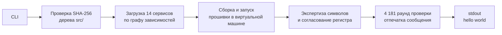
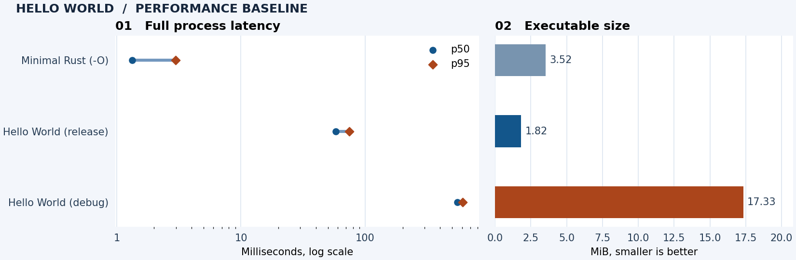

# Hello World · Enterprise Edition

[](https://github.com/seladala/hello-world-rust/actions/workflows/ci.yml)
[](https://github.com/seladala/hello-world-rust/releases/latest)
[](rust-toolchain.toml)

Конвейер утверждения приветствия на Rust. На выходе ровно **одна строка, 12 байт**. По дороге — **14 сервисов**, **4 181 раунд проверки** и **67 000 строк в `src/main.rs`**. Приветствие принято единогласно.

[Запуск](#запуск) · [Архитектура](#архитектура) · [Производительность](#производительность) · [Релизы](#релизы) · [Как внести изменения](CONTRIBUTING.md)

## Запуск

Установите Rust через [rustup](https://rustup.rs/). Из корня клона:

```sh
cargo run --locked
```

```text
hello world
```

| Команда | Результат |
| --- | --- |
| `cargo run --locked -- --help` | Справка по CLI |
| `cargo run --locked -- --version` | Версия программы |
| `cargo run --locked -- -vv` | Диагностика в stderr |
| `cargo run --locked -- --disassemble` | Листинг прошивки в stderr и приветствие в stdout |

## Архитектура



| Узел | Где искать | Зачем он нужен |
| --- | --- | --- |
| Граф сервисов | [services.json](src/core/manifests/services.json) | Определяет порядок загрузки и зависимости |
| Прошивка и VM | [runtime](src/core/runtime/) | Собирает и исполняет прошивку приветствия |
| Ревизионная комиссия | [validation](src/core/validation/) | Проверяет символы и приводит вывод к нижнему регистру |
| Контроль целостности | [checksums.sha256](src/core/security/checksums.sha256) | Фиксирует содержимое исходников, настроек и прошивки |
| Финальная проверка | [main.rs](src/main.rs) | Сверяет отпечаток сообщения после каждого раунда |

## Производительность

Сравнение трёх способов получить те же 12 байт. Измерено **полное время запуска процесса**, включая работу загрузчика, проверки и вывод в захваченную трубу. Компиляция прошла до замеров. У каждого варианта было 5 прогревочных и 50 измеренных запусков. В каждой серии порядок вариантов перемешивался.



| Вариант | Медиана | p95 | Размер файла |
| --- | ---: | ---: | ---: |
| Минимальный Rust (`println!`, `-O`) | 1,33 мс | 2,98 мс | 3,52 МиБ |
| Hello World, release | 57,80 мс | 74,34 мс | 1,82 МиБ |
| Hello World, debug | 550,49 мс | 606,70 мс | 17,33 МиБ |

В этом прогоне release выводил приветствие **в 9,5 раза быстрее debug** по медиане. Минимальный Rust опередил release примерно **в 43 раза**. Размеры относятся к исполняемым файлам с настройками этих сборок. Архивы релиза также содержат дерево `src/`.

Замер сделан на Linux x86-64 с Rust 1.87.0. p95 рассчитан методом ближайшего ранга. Версия ядра, модель CPU, коммит и все отсчёты сохранены в [JSON-отчёте](docs/performance/baseline.json). Время запуска зависит от диска, CPU и нагрузки машины.

<details>
<summary>Воспроизвести замер и построить графики</summary>

Требуются Linux, Python 3 и установленный Rust. Для построения графиков нужен Matplotlib.

```sh
cargo build --locked
cargo build --locked --release
python3 scripts/benchmark.py --output benchmark.json
python3 scripts/plot_benchmark.py benchmark.json benchmark.png
```

[Benchmark в GitHub Actions](https://github.com/seladala/hello-world-rust/actions/workflows/benchmark.yml) выполняет тот же замер и сохраняет JSON как артефакт.

</details>

## Релизы

Скачайте архив и соседний файл `.sha256` на странице [Releases](https://github.com/seladala/hello-world-rust/releases/latest). Распакуйте архив целиком. Лаунчер сам найдёт дерево `src/`, необходимое проверке целостности.

| Платформа | Архив | Команда из распакованной папки |
| --- | --- | --- |
| Linux x86-64 (glibc 2.39+) | `*x86_64-unknown-linux-gnu.tar.gz` | `./hello-world` |
| macOS Apple Silicon | `*aarch64-apple-darwin.tar.gz` | `./hello-world` |
| Windows x86-64 | `*x86_64-pc-windows-msvc.zip` | `hello-world.cmd` в cmd.exe |

Проверка перед распаковкой. Замените `ARCHIVE` именем скачанного архива.

| Платформа | Команда |
| --- | --- |
| Linux | `sha256sum -c ARCHIVE.sha256` |
| macOS | `shasum -a 256 -c ARCHIVE.sha256` |
| Windows PowerShell | Сравните `(Get-FileHash ARCHIVE -Algorithm SHA256).Hash` с хешем в файле `.sha256`. |

## Проверки и сопровождение

- [CI](https://github.com/seladala/hello-world-rust/actions/workflows/ci.yml) проверяет форматирование, Clippy и хеши исходников на Linux и прогоняет тесты на Linux, macOS и Windows.
- [Release](https://github.com/seladala/hello-world-rust/actions/workflows/release.yml) собирает архивы из тега, запускает каждый распакованный комплект и публикует архивы с SHA-256.
- [CONTRIBUTING](CONTRIBUTING.md) описывает локальные проверки и выпуск тегов. [CHANGELOG](CHANGELOG.md) хранит историю выпусков.

---

**НЕ ВАЙБКОД ✅** Приветствие проверено. Протокол подшит. 🤝
